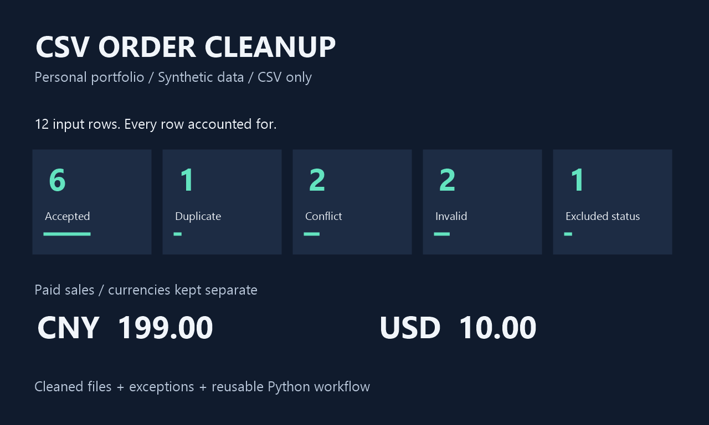

# CSV order-line portfolio demo

A synthetic demonstration, not a customer project. Python 3.11+ and its standard library are the only requirements. No installation or downloads are needed. XLSX is not supported.



```text
python -m unittest -v
python order_cleaner.py --input samples/orders_a.csv samples/orders_b.csv --output demo-output-new
```

Use a new output directory each run; the committed `demo-output` already exists, so choose `demo-output-new` to reproduce it. The API is `run_pipeline(inputs: list[Path], output_dir: Path) -> dict[str, int]`.

Each source row represents one order line. `line_amount` is the whole-line sales value, not a unit price. The two hand-written sample files are entirely fictional and contain deliberate errors and duplicates.

## Outputs and processing policy

* `cleaned.csv`: valid paid rows retained in source order.
* `summary.csv`: quantity and whole-line amounts grouped by currency and SKU. Different currencies are never added together.
* `audit.csv`: every source row, its 1-based input index, basename, physical CSV starting line, disposition, reason, and original field values. Index plus basename distinguishes same-name files. Absolute host paths are not exported.
* `summary.json`: mutually exclusive row counts that sum to `input_rows`.

Surrounding whitespace is trimmed for comparison and validation. Identifiers remain strings, preserving leading zeros. Required headers must match the documented sample exactly and in order. Missing, extra, duplicate or empty headers, invalid UTF-8, malformed widths or quoting are fatal before output creation. UTF-8 BOM is supported. Limits: 10,000 records across all inputs, 20 columns maximum (the exact required schema has eight), 10 MB per file, and 4,096 characters per field. All fields are required. Dates must be real dates in exact YYYY-MM-DD form; quantities must be non-negative integer digits; amounts must be finite non-negative plain decimals with at most two decimal places; currencies must be three uppercase ASCII letters; statuses must be lowercase paid, cancelled or refunded. Blank numeric fields are invalid; zero is valid. Decimal arithmetic preserves exact sums.

The unique key is `(order_id, line_id)`. Before validation/exclusion, compare every trimmed source field for keys with both identifiers present. If any payload differs, **all** rows for that key are conflicts, even when a differing payload is invalid. Otherwise the first copy continues through validation/status handling and later identical copies are duplicates. Invalid rows are withheld; valid cancelled/refunded rows are audited and excluded from sales. Blank keys never group unrelated invalid rows. These are demonstration business rules to confirm with a client, not universal order semantics.

CSV export prefixes an apostrophe to the entire value when its first character after any Unicode whitespace, control or format characters is `=`, `+`, `-`, or `@`. The prefix scan uses Python's Unicode whitespace classification and Unicode categories Cc/Cf, including non-breaking spaces and zero-width format characters. This applies to original audit values as well; memory and input files retain originals. The audit is therefore a spreadsheet-safe representation, not a byte-for-byte archive. Spreadsheet users must import identifier columns as **Text** to preserve leading zeros: CSV cannot prescribe native cell types.

## Manual reconciliation

12 input rows = 6 accepted + 1 duplicate + 2 conflicts + 2 invalid + 1 excluded status.

Raw CNY amounts: 351.00. Subtract invalid 15.00, conflicts 59.00, cancelled 29.00, and duplicate 49.00: accepted CNY = **199.00**. The invalid blank quantity still retains its 5.00 original amount in the audit. Accepted USD = **10.00**, kept separately.

| Currency | SKU | Quantity | Amount |
|---|---|---:|---:|
| CNY | CUP | 5 | 145.00 |
| CNY | BAG | 1 | 49.00 |
| CNY | =2+2 (escaped in CSV) | 1 | 5.00 |
| CNY | PEN | 1 | 0.00 |
| USD | CUP | 1 | 10.00 |

The tests independently assert these hand-calculated values, input hashes, formula escaping, validation, duplicates, conflict precedence, fatal errors, record limits, and CLI behavior. Execution was verified on Python 3.14; Python 3.11 compatibility is based on standard APIs and syntax used, not a separate runtime test. Output-writing filesystem failures may leave a partially written new output directory; rerun using a new path after resolving the failure.

## 中文摘要

这是纯虚构数据的作品集演示，不是客户项目。仅依赖 Python 标准库，支持 CSV，不支持 XLSX。按订单号和行号去重；冲突、无效记录及取消/退款记录均留审计记录，只有有效已付款行进入汇总。人民币 199.00 与美元 10.00 分开统计。表格软件导入编号列时请选择“文本”，以保留前导零。

## Book a CSV-only service

[View CSV cleanup and Python automation packages on Fiverr](https://www.fiverr.com/gorge_zhao/clean-csv-files-and-automate-order-reports-with-python). Packages are US$45 / US$75 / US$120 with 2 / 3 / 4-day delivery and one revision within the agreed scope.

Send an anonymized sample through Fiverr before ordering so we can confirm columns, duplicate keys, sales rules, and your running environment. Fiverr orders use the package scope and delivery terms shown there; communication and payment for those orders stay on Fiverr.
